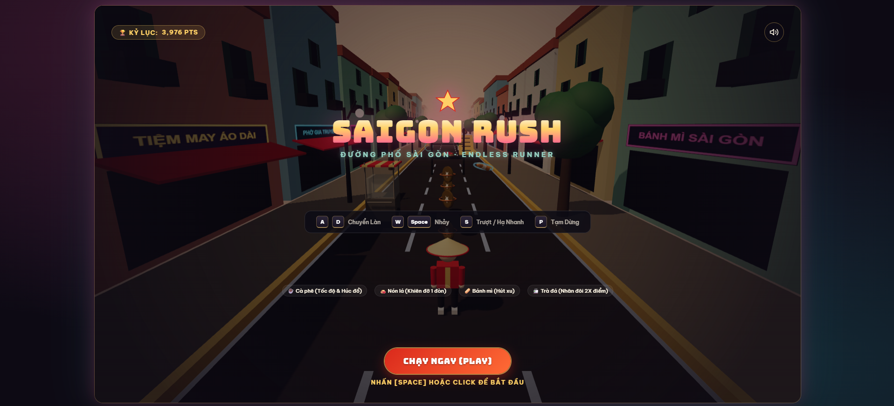

# Saigon Rush (Sài Gòn Rực Lửa) 🏃‍♂️💨🛵

A vibrant, fast-paced Vietnamese-themed 3D endless runner game set in the bustling streets of Ho Chi Minh City (Saigon). Dodge chaotic street traffic, leap over plastic stools, duck under tangled overhead wires, dash up Saigon bus roofs, collect golden Dong coins, and power up with iconic Vietnamese street food delicacies!

Built with **React 19**, **Three.js**, **React Three Fiber (R3F)**, **`@react-three/drei`**, **Zustand**, and **Vite**.

---

## Video Demo

[](https://www.youtube.com/watch?v=xAmkN12MT7Y)

## 🎮 Gameplay & Features

- **Iconic Saigon Street Obstacles**:
  - 🪑 **Low Plastic Stools (Ghế nhựa vỉa hè)**: Low barriers requiring a jump (`Space` / `Up Arrow`).
  - ⚡ **Overhead Electrical Wires (Dây điện chằng chịt)**: Hanging power lines requiring a slide/duck (`Down Arrow` / `S`).
  - 🛵 **Saigon Motorbikes (Xe máy Honda Wave/Cub)**: Fast-moving or stationary scooters blocking lanes.
  - 🍜 **Street Food Carts (Xe Hủ Tiếu / Xe Bánh Mì)**: Stainless steel carts with striped canopies blocking an entire lane.
  - 🚌 **Saigon Blue Buses (Xe Buýt Sài Gòn)**: Massive obstacles featuring a chevron front ramp allowing runners to dash up onto the walkable rooftop!

- **Authentic Vietnamese Power-Ups**:
  - ☕ **Cà Phê Sữa Đá (Vietnamese Iced Coffee)**: +40% Speed Rush, obstacle smashing invulnerability, dilated camera FOV, and golden speed aura (6s).
  - 👒 **Nón Lá (Conical Straw Hat)**: Protective shield absorbing 1 collision crash with 1.5s invulnerability frames.
  - 🥖 **Bánh Mì (Crispy Baguette)**: Coin Magnet pulling all coins within a 12m radius across all 3 lanes directly to the player (8s).
  - 🥤 **Trà Đá (Saigon Iced Tea)**: 2X Score Multiplier doubling distance score and coin bonuses (10s).

- **Audio Engine**:
  - Zero-latency procedural Web Audio API synthesizers for jump whooshes, slide rustles, coin chimes, shield shatter, and crash thuds.
  - 124 BPM Saigon street-beat synth music with user-gesture autoplay unlock.

- **Dual 3D Asset Pipeline**:
  - Optimized binary GLB models (`public/assets/models/`) with automatic procedural Three.js fallbacks and React Error Boundaries.

---

## 🕹️ Controls

| Action | Keyboard Keys | Mobile / Touch |
| :--- | :--- | :--- |
| **Move Left / Right** | `A` / `D` or `Left` / `Right` Arrow | Swipe Left / Swipe Right |
| **Jump** | `W` / `Up` Arrow / `Space` | Swipe Up |
| **Slide / Duck** | `S` / `Down` Arrow | Swipe Down |
| **Fast Fall** | `S` / `Down` Arrow (while airborne) | Swipe Down |
| **Pause / Resume** | `P` or `Escape` | Pause Button |
| **Mute / Unmute** | Audio Icon (Top-Right) | Audio Button |

---

## 🛠️ Tech Stack

- **Runtime & Framework**: React 19, Vite 6
- **3D Graphics**: Three.js (r186), React Three Fiber (v9), `@react-three/drei` (v10)
- **State Management**: Zustand 5
- **Audio**: Web Audio API (procedural synthesis)
- **Styling**: Vanilla CSS (Responsive 16:9 arcade cabinet presentation)

---

## 🚀 Getting Started

### Prerequisites
- Node.js 18+ installed

### Installation & Run
```bash
# Clone the repository
git clone https://github.com/HemlockPham7/saigonrush.git
cd saigonrush

# Install dependencies
npm install

# Start local development server
npm run dev
```

Open `http://localhost:5173/` in your browser to play.

### Production Build
```bash
npm run build
npm run preview
```

---

## 🤖 AI Model Usage & Development Metrics

This project was pair-programmed and architected using **Antigravity IDE** leveraging dual AI models across different phases:
- **Gemini 3.8 Flash**: System planning, PRD/Architecture specs, procedural geometry generation, sound synthesis engine, and asset optimization.
- **Claude Opus 5.5**: Core gameplay mechanics, lane transition mathematics, and state management integration.

### Quota & Usage Snapshot

| Model Family | Limit Type | Remaining | Refresh Window | Status |
| :--- | :--- | :---: | :--- | :---: |
| **Gemini Models** | Weekly Limit | **95%** | Fully refreshes in 6 days, 21 hours | 🟢 Healthy |
| **Gemini Models** | 5-Hour Limit | **82%** | Fully refreshes in 2 hours, 51 minutes | 🟢 Healthy |
| **Claude & GPT Models** | Weekly Limit | **77%** | Fully refreshes in 6 days, 22 hours | 🟢 Healthy |
| **Claude & GPT Models** | 5-Hour Limit | **54%** | Fully refreshes in 3 hours, 20 minutes | 🟡 Active |

```
Gemini Models
Weekly Limit Remaining
You have used some of your weekly limit, it will fully refresh in 6 days, 21 hours.
95%
Five Hour Limit Remaining
You have used some of your 5-hour limit, it will fully refresh in 2 hours, 51 minutes.
82%

Claude and GPT models
Weekly Limit Remaining
You have used some of your weekly limit, it will fully refresh in 6 days, 22 hours.
77%
Five Hour Limit Remaining
You have used some of your 5-hour limit, it will fully refresh in 3 hours, 20 minutes.
54%
```

---

